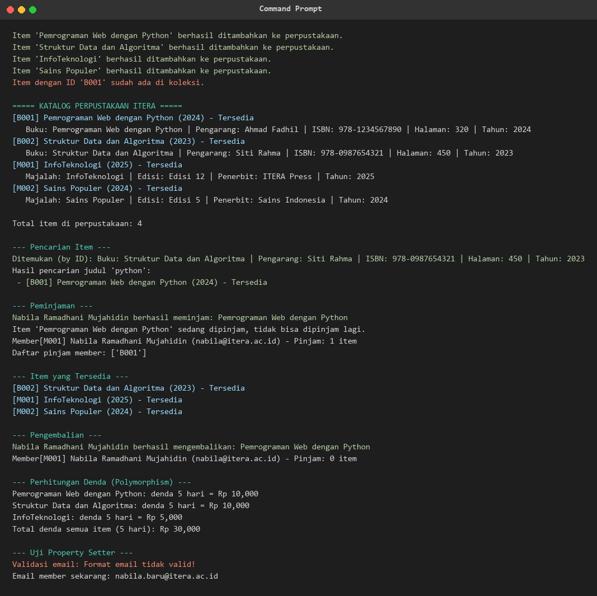

# Praktikum Pemrograman Web - Pertemuan 5
## Python Object-Oriented Programming (OOP)

### Identitas Mahasiswa
- Nama Lengkap: Nabila Ramadhani Mujahidin
- NIM: 123140062
- Kelas Praktikum: RA

### Deskripsi Program
Program ini merupakan implementasi konsep Object-Oriented Programming (OOP) dengan Python.
Terdapat dua bagian:

1. Folder `latihan/` berisi contoh hands-on dari materi praktikum (class, object,
   inheritance, encapsulation, polymorphism, dan abstract class).
2. Folder `tugas_perpustakaan/` berisi sistem manajemen perpustakaan sederhana.

Penerapan 4 pilar OOP pada tugas perpustakaan:
- Class & Object: LibraryItem, Book, Magazine, Member, Library.
- Inheritance: Book dan Magazine mewarisi LibraryItem.
- Encapsulation: atribut protected (`_`) dan private (`__`) dengan name mangling,
  serta akses melalui property getter/setter.
- Polymorphism: method `get_detail()` dan `hitung_denda()` dioverride pada setiap
  subclass, serta dipanggil secara polimorfik pada koleksi heterogen.
- Abstraction: LibraryItem merupakan abstract class dengan abstract method.

### Struktur Berkas
```
Nabila_123140062_pertemuan5/
|-- latihan/
|   |-- 01_everything_is_object.py
|   |-- 01_procedural_vs_oop.py
|   |-- 02_class_object.py
|   |-- 03_inheritance.py
|   |-- 04_encapsulation.py
|   |-- 05_polymorphism.py
|   `-- 06_abstract_class.py
|-- tugas_perpustakaan/
|   |-- library_item.py
|   |-- member.py
|   |-- library.py
|   |-- main.py
|   `-- screenshot.png
|-- README.md
`-- .gitignore
```

### Panduan Menjalankan Program
Jalankan latihan:
```
cd latihan
python 02_class_object.py
```

Jalankan tugas perpustakaan:
```
cd tugas_perpustakaan
python main.py
```

### Screenshot Output
Screenshot terminal saat menjalankan `python main.py` (fitur penambahan item,
penampilan katalog, pencarian item, peminjaman, dan perhitungan denda):


