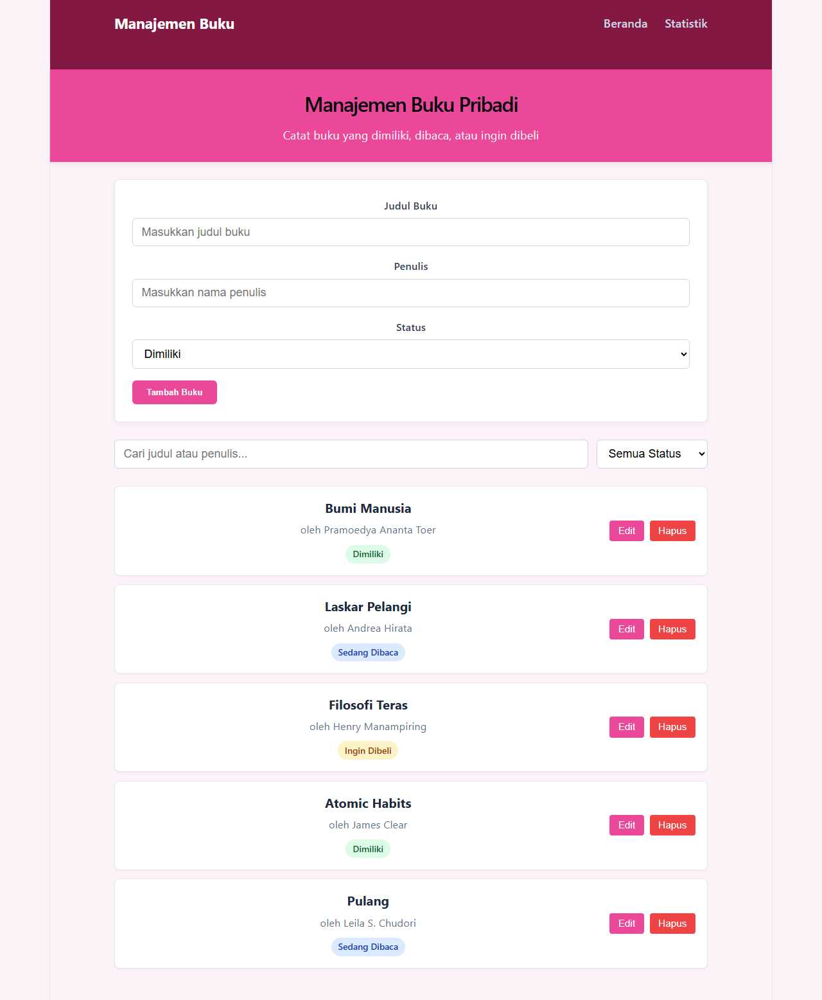
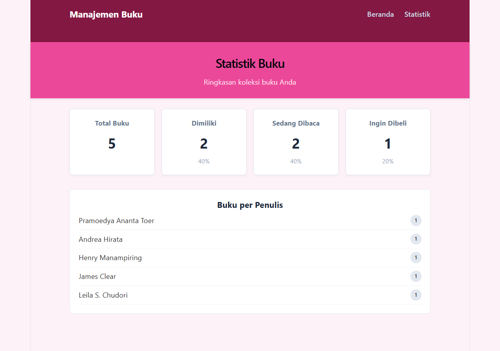

# Manajemen Buku Pribadi

Aplikasi manajemen buku pribadi yang memungkinkan pengguna mencatat buku-buku yang dimiliki, sedang dibaca, atau ingin dibeli.

## Deskripsi

Aplikasi web berbasis React (Vite) untuk mencatat koleksi buku pribadi. Pengguna dapat menambah, mengedit, dan menghapus buku, melakukan filter berdasarkan status, serta mencari buku berdasarkan judul atau penulis. Data disimpan secara persisten menggunakan `localStorage`.

## Instruksi Instalasi dan Menjalankan

```bash
# Masuk ke folder project
cd Nabila_123140062_pertemuan3

# Pasang dependensi
npm install

# Jalankan development server
npm run dev
```

Aplikasi akan berjalan di `http://localhost:5173`.

Menjalankan unit test:

```bash
npm test
```

## Screenshot Antarmuka

### Halaman Beranda
Menampilkan form tambah buku, filter status, pencarian, serta daftar buku.



### Halaman Statistik
Menampilkan ringkasan total buku, jumlah per status, dan jumlah buku per penulis.



## Fitur React yang Digunakan

- Functional components dengan Hooks (`useState`, `useEffect`, `useMemo`, `useCallback`)
- Custom hooks: `useLocalStorage` dan `useBookStats`
- Context API (`BookContext`) untuk state management global
- React Router untuk navigasi multi-halaman (Home, Stats, 404)
- PropTypes untuk type checking pada seluruh komponen
- React Testing Library + Vitest untuk unit test (14 test lulus)

## Struktur Folder

```
src/
├── components/
│   ├── BookForm/
│   ├── BookItem/
│   ├── BookList/
│   ├── BookFilter/
│   ├── Header/
│   └── Navbar/
├── pages/
│   ├── Home/
│   ├── Stats/
│   └── NotFound/
├── hooks/
│   ├── useLocalStorage.js
│   └── useBookStats.js
├── context/
│   └── BookContext.jsx
├── App.jsx
└── main.jsx
```