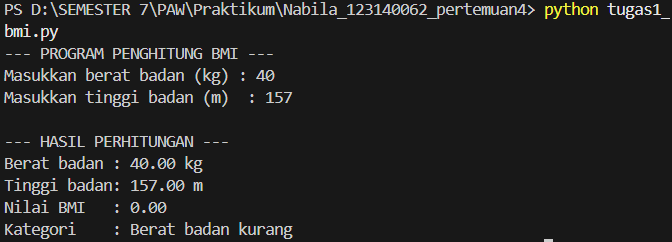
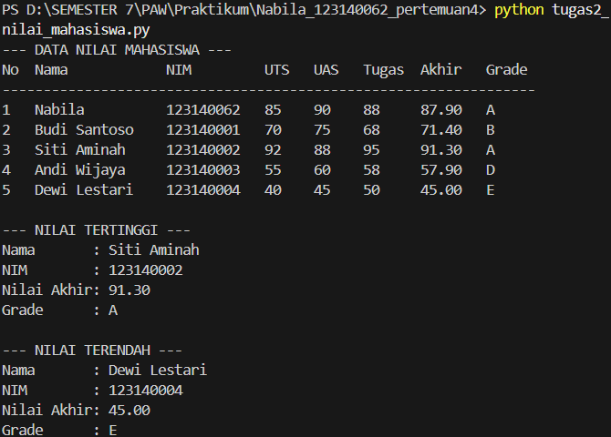
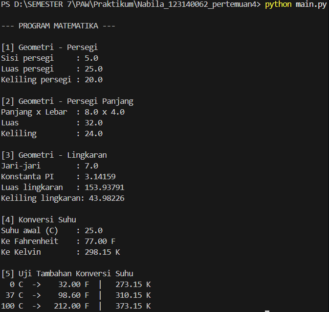

# Praktikum Pemrograman Web - Pertemuan 4

## Identitas Mahasiswa
- **Nama** : Nabila Ramadhani Mujahidin
- **NIM**  : 123140062

## Deskripsi
Repositori ini berisi tugas praktikum Pertemuan 4 (Python Dasar) yang mencakup
variabel dan tipe data, struktur kendali, fungsi, struktur data koleksi, serta
pembuatan modul kustom.

## Struktur Berkas
- `tugas1_bmi.py` : Program penghitung Body Mass Index (BMI) sederhana.
- `tugas2_nilai_mahasiswa.py` : Program pengelolaan data nilai mahasiswa.
- `math_operations.py` : Modul matematika (geometri dan konversi suhu).
- `main.py` : Program utama yang menggunakan modul `math_operations`.
- `.gitignore` : Daftar berkas/folder yang diabaikan Git.

## Cara Menjalankan
Pastikan Python 3.8+ telah terpasang. Jalankan perintah berikut di terminal
(dari dalam folder proyek):

```bash
python tugas1_bmi.py
python tugas2_nilai_mahasiswa.py
python main.py
```

Pada beberapa sistem, gunakan `python3` sebagai pengganti `python`.

## Screenshot Hasil Eksekusi


