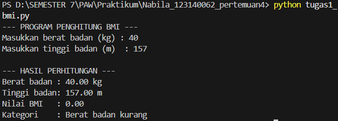
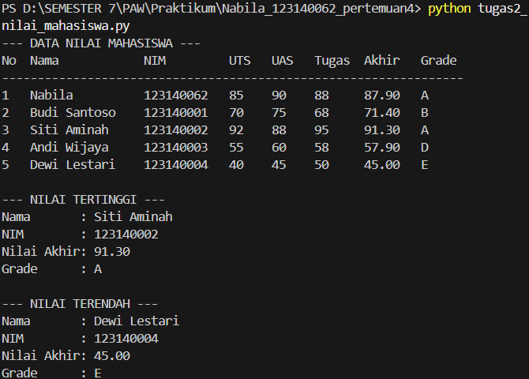
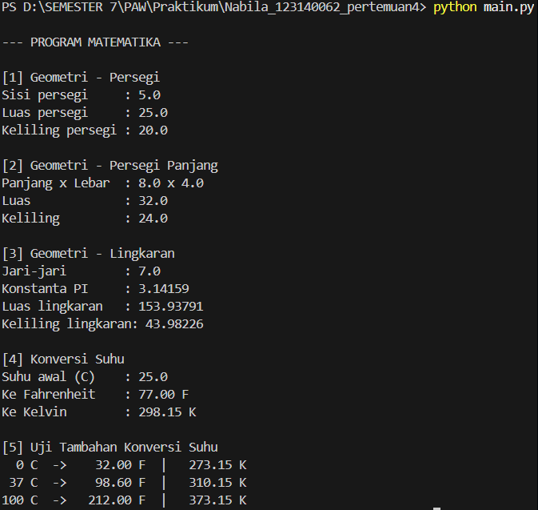

# Tugas Praktikum Pertemuan 4 - Dasar Pemrograman Python

## Identitas Mahasiswa

- Nama: Nabila Ramadhani Mujahidin
- NIM: 123140062

## Deskripsi

Kumpulan program Python untuk tugas praktikum Pertemuan 4:
1. `tugas1_bmi.py` - Penghitung BMI (Body Mass Index) dengan kategori.
2. `tugas2_nilai_mahasiswa.py` - Pengelolaan data nilai mahasiswa (list of dict), nilai akhir, grade, tabel, dan analisis tertinggi/terendah.
3. `math_operations.py` - Modul matematika (luas & keliling 3 bentuk geometri, konversi suhu, konstanta PI).
4. `main.py` - Program utama yang mengimpor dan menggunakan `math_operations` dengan dua cara impor berbeda.

## Instruksi Menjalankan

Pastikan Python 3.8+ terpasang. Buka terminal di folder project ini, lalu jalankan:

```bash
python tugas1_bmi.py
python tugas2_nilai_mahasiswa.py
python main.py
```

(Untuk menguji modul secara mandiri: `python math_operations.py`)

## Screenshot Eksekusi

<!-- Tambahkan screenshot hasil eksekusi program di terminal -->




## Komentar dan Docstring

Setiap fungsi dilengkapi docstring yang menjelaskan parameter dan nilai kembaliannya. Kode mengikuti konvensi PEP 8 (indentasi 4 spasi, penamaan snake_case).